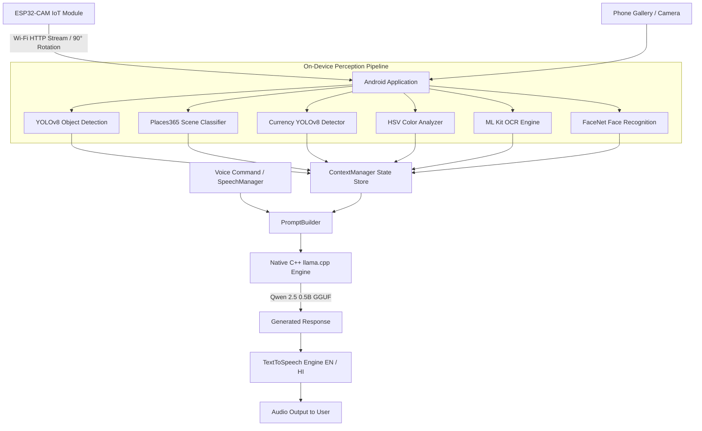

# 👁️ DivyaDristi (दिव्य दृष्टि)
### *Edge AI & IoT Vision Assistant for the Visually Impaired*

[](https://www.android.com/)
[](https://kotlinlang.org/)
[](https://github.com/ggerganov/llama.cpp)
[](https://www.espressif.com/)
[](LICENSE)

---

## 📌 Overview

**DivyaDristi** (*Divine Vision*) is an edge-powered assistive vision system designed to empower visually impaired individuals with complete spatial independence. By pairing an **ESP32-CAM wearable IoT camera** with an **Android smartphone**, the system performs **100% on-device AI inference**—meaning all perception, scene analysis, optical character recognition, currency identification, and local LLM reasoning run **completely offline without requiring an active internet connection or cloud subscription.**

---

## 🚀 Key Features

### 🔍 1. Real-Time Spatial Object Detection & Obstacle Warning
* **Model**: YOLOv8 Nano (TFLite, 80 COCO classes).
* **Spatial Mapping**: Categorizes detected entities into **Left**, **Center**, and **Right** visual fields.
* **Proximity Alerts**: Real-time proximity calculation triggers urgent safety warnings (e.g., *"Caution: A chair is right in front of you, very close."*).
* **Smart Entity Summarization**: Avoids repetitive audio spam by grouping multiple detections (e.g., *"few persons"*, *"a bicycle and two chairs"*).

### 💵 2. Indian Currency Recognition (Offline)
* **Model**: Custom YOLOv8 detector trained on Indian Rupee banknotes.
* **Denominations**: Detects **₹10, ₹20, ₹50, ₹100, ₹200, ₹500, and ₹2000** notes.
* **Class-Agnostic NMS**: Eliminates conflicting label predictions on single banknotes, providing verified, reliable monetary confirmation.

### 🌐 3. Scene & Environment Classification
* **Model**: Places365 (TFLite, 365 scene categories).
* **Contextual Awareness**: Informs the user whether they are inside an office, kitchen, corridor, street, grocery store, or park with calibrated confidence metrics.

### 🎨 4. Dominant & Object Color Detection
* **Method**: Real-time HSV color space clustering.
* **Per-Object Color Binding**: Pairs detected objects with their observed color (e.g., *"blue bottle"*, *"red backpack"*).
* **Scene Dominant Color**: Quick voice command response for ambient clothing and surface color queries.

### 👤 5. On-Device Face Recognition & Registration
* **Detection & Alignment**: Google ML Kit Face Detection + custom face cropper.
* **Embedding Model**: FaceNet (128-dimensional L2-normalized embeddings via TFLite).
* **Local Database**: Embedded **Room Database** storing biometric signatures locally.
* **Custom Tagging**: Register trusted family members and friends by name and relationship (e.g., *"Your brother Ramesh is in front of you"*).

### 📖 6. Text-to-Speech Optical Character Recognition (OCR)
* **Engine**: Google ML Kit On-Device Text Recognition.
* **Preprocessing**: Contrast enhancement and grayscale binarization pipeline for reading signs, product packaging, and printed documents aloud.

### 🧠 7. Fully Offline On-Device LLM (Conversational Assistant)
* **Model**: **Qwen 2.5 0.5B Instruct** (`qwen2.5-0.5b-instruct-q4_k_m.gguf`).
* **Runtime**: Native C++ **`llama.cpp`** integrated via custom JNI bridge (`libllm_native.so`).
* **Hardware Acceleration**: Multi-threaded ARM NEON execution (`armv8.2-a+dotprod+fp16`).
* **Dynamic Context Injection**: Merges real-time sensor context (detected objects, faces, colors, text, currency) into the LLM prompt to answer natural questions (e.g., *"What is on the table to my left?"*).

### 🇮🇳 8. Bilingual Accessibility (English & Hindi)
* **Full Localization**: Complete UI localization in Hindi and English.
* **Voice Commands & TTS**: Speech-to-text recognition and text-to-speech audio feedback in both languages.
* **Offline ML Kit Translation**: Live English-to-Hindi translation for perception outputs.

---

## 🛠️ Architecture & Dataflow



---

## 🔌 Hardware Setup (ESP32-CAM)

The IoT wearable camera module streams frames wirelessly to the smartphone:

| Parameter | Configuration |
| :--- | :--- |
| **Wi-Fi Mode** | SoftAP (Access Point) |
| **SSID** | `ESP32_CAM_AP` |
| **Password** | `12345678` |
| **Default IP** | `192.168.4.1` |
| **Capture Endpoint** | `http://192.168.4.1/capture` |
| **Mount Orientation** | Horizontal wearable clip (app auto-compensates with +90° rotation) |

### Wiring & Power
1. Power the ESP32-CAM using a regulated 5V power bank or lithium-ion battery with a 3.3V/5V LDO buck converter.
2. Ensure GPIO 0 is disconnected from GND during normal operation (connected only during firmware flashing).

---

## 📂 Neural Network Models

All neural models are placed directly inside `app/src/main/assets/`:

| File | Type | Framework | Purpose |
| :--- | :--- | :--- | :--- |
| `yolov8n_float32.tflite` | Object Detection | TFLite | Real-time 80-class object perception |
| `Currency_32.tflite` | Currency Detection | TFLite | Indian Rupee banknote detection |
| `places365_float32.tflite` | Scene Classification | TFLite | 365 environment classes |
| `facenet.tflite` | Face Embeddings | TFLite | 128-d face recognition vector |
| `models/qwen2.5-0.5b-instruct-q4_k_m.gguf` | Language Model | GGUF (llama.cpp) | Offline conversational reasoning |

> [!NOTE]  
> **RAM Recommendations for GGUF Model:**  
> * **Devices with 4 GB+ RAM**: Use `qwen2.5-0.5b-instruct-q4_k_m.gguf` (Recommended).  
> * **Devices with 3 GB or less RAM**: Quantize to `q3_k_m` or `q2_k` using llama.cpp quantization tools to preserve memory.

---

## 📁 Repository Structure

```text
DivyaDristi/
├── app/
│   ├── src/
│   │   ├── main/
│   │   │   ├── assets/              # TFLite & GGUF Model weights, label maps
│   │   │   │   ├── models/          # Qwen2.5 GGUF LLM
│   │   │   │   ├── Currency_32.tflite
│   │   │   │   ├── facenet.tflite
│   │   │   │   ├── places365_float32.tflite
│   │   │   │   └── yolov8n_float32.tflite
│   │   │   ├── cpp/                 # Native C++ llama.cpp integration
│   │   │   │   ├── CMakeLists.txt
│   │   │   │   ├── llm_jni.cpp      # JNI bridge
│   │   │   │   ├── llm/             # Native InferenceEngine implementation
│   │   │   │   └── llama.cpp/       # llama.cpp submodule/core
│   │   │   ├── java/com/krushna/divyadrishti/
│   │   │   │   ├── color/           # Fast HSV color segmentation
│   │   │   │   ├── face/            # Face detection, embedding & Room DB
│   │   │   │   ├── language/        # Language management (English/Hindi)
│   │   │   │   ├── llm/             # LLMManager, PromptBuilder, IntentClassifier
│   │   │   │   ├── model/           # ContextManager and unified perception state
│   │   │   │   ├── ocr/             # ML Kit OCR & image preprocessor
│   │   │   │   ├── speech/          # SpeechRecognizer & VoiceCommandListener
│   │   │   │   ├── translation/     # ML Kit on-device translation
│   │   │   │   └── MainActivity.kt  # Core activity & pipeline orchestrator
│   │   │   └── res/                 # UI layouts, icons, localized strings
│   │   └── build.gradle.kts
├── gradle/
└── README.md
```

---

## ⚙️ Build & Installation

### Prerequisites
* **Android Studio**: Ladybug / Koala / Iguana or newer.
* **Android SDK**: API 35 (Compile), API 24+ (Min).
* **Android NDK**: Version `30.0.15729638` or newer.
* **CMake**: Version `3.22.1` or newer.
* **Device**: ARM64-v8a Android smartphone with at least 4 GB RAM recommended.

### Steps
1. **Clone the repository**:
   ```bash
   git clone https://github.com/RONIN-46/DivyaDristi.git
   cd DivyaDristi
   ```

2. **Download / Verify Model Weights**:
   Ensure `qwen2.5-0.5b-instruct-q4_k_m.gguf` is placed in:
   ```text
   app/src/main/assets/models/qwen2.5-0.5b-instruct-q4_k_m.gguf
   ```

3. **Open in Android Studio**:
   * Open the project in Android Studio.
   * Allow Gradle to sync dependencies and configure CMake.

4. **Build and Run**:
   * Connect your Android device via USB debugging.
   * Select `app` and click **Run (Shift + F10)**.

---

## 📱 How to Use

1. **Power on ESP32-CAM**: Wait for the `ESP32_CAM_AP` Wi-Fi network to appear.
2. **Connect**: Tap **CONNECT** in the app. DivyaDristi will bind to the camera's network and establish the video stream.
3. **Capture / Auto Mode**:
   * **Manual**: Tap **CAPTURE IMAGE** anytime to take a snapshot and run full scene analysis.
   * **Auto Mode**: Toggle **AUTO** to have the system periodically perceive the environment (default: every 30 seconds).
4. **Voice Assistance**:
   * Tap the voice card or say commands like *"What is in front of me?"*, *"Read text"*, *"What color is this?"*, or *"Switch to Hindi"*.
5. **Currency Mode**:
   * Enable the **Currency Model** switch and show any Indian Rupee banknote to hear its denomination instantly.
6. **Register Faces**:
   * Point the camera at a family member or friend and tap **Register Face** to save their name and relation for future recognition.

---

## 📄 License

This project is licensed under the **MIT License** - see the [LICENSE](LICENSE) file for details.